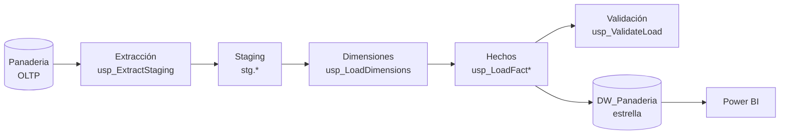

# Pastelería y Panadería DEREK: Datamart de Inteligencia de Negocios

Proyecto final de **Base de Datos Avanzadas y Big Data** (Ingeniería de Sistemas Computacionales, 2026-2).
Solución BI que centraliza ventas, compras e inventario de la Pastelería y Panadería DEREK en un datamart con esquema en estrella, cargado mediante un proceso ETL/ELT en SQL Server y consumido desde Power BI.

## Equipo

| Autor | Participación |
| --- | --- |
| Gallardo Diaz Yessenia Lisbeth | 100 % |
| Julca Leon Laura Yanira | 100 % |
| Leon Delgado Haydee Anayely | 100 % |
| Martinez Mendoza Celinda Cedamar | 100 % |

- **Docente:** Patricia Janet Uceda Martos
- **Curso / NRC:** Base de Datos Avanzadas y Big Data / 16025
- **Ciudad:** Cajamarca, Perú

## Problema y objetivo

El negocio no tenía una base de datos centralizada: el control de inventario era manual, los pedidos del bot de WhatsApp dependían de revisión constante del dueño (unas 12 horas semanales) y no había visibilidad de ventas ni de productos por vencer.
El objetivo es consolidar esa información en un datamart y ofrecer indicadores (KPI) que apoyen las decisiones de producción, compras y atención al cliente.

## Arquitectura



- **Metodología:** Kimball, entrega bottom-up.
- **Patrón de carga:** upsert SCD tipo 1 en dimensiones; full refresh controlado en `FactSales` y `FactPurchases`; `FactInventory` guarda una foto por día.
- **Orquestación y auditoría:** `etl.usp_RunETL` registra cada lote en `etl.LoadAudit` (RUNNING, SUCCEEDED, FAILED).

## Modelo en estrella

| Tipo | Tablas |
| --- | --- |
| Hechos (3) | `FactSales`, `FactPurchases`, `FactInventory` |
| Dimensiones (7) | `DimDate`, `DimProduct`, `DimCustomer`, `DimEmployee`, `DimSupplier`, `DimOrderStatus`, `DimChannel` |

- **Grano de `FactSales`:** una línea de `DetalleVenta`.
- **Regla del grano:** el total de la cabecera de venta no se copia a las líneas, para no duplicarlo al sumar.

## Estructura del repositorio

```
.
├── README.md
├── sql/
│   └── DW_Panaderia_datamart_completo.sql   # crea la base, el modelo, el ETL y las vistas
├── powerbi/
│   └── dashboard.pbix                       # tablero de Power BI
├── docs/
│   └── Informe_Proyecto_Final.docx          # informe técnico
└── evidencias/                              # capturas, logs y resultados (E-01, E-02, ...)
```

## Requisitos

- SQL Server 2017 o superior (Express es suficiente)
- SQL Server Management Studio (SSMS)
- Power BI Desktop
- La base operativa `Panaderia` ya creada en la misma instancia

## Cómo ejecutar

1. Abre `sql/DW_Panaderia_datamart_completo.sql` en SSMS.
2. **Cambia la sal de seudonimización:** en `etl.Config`, el valor `CustomerSalt` (`DEREK-2026-CAMBIAR`).
3. Si tu base fuente no se llama `Panaderia`, reemplaza `Panaderia.dbo.` en la sección 3 del script.
4. Ejecuta el script completo. Crea `DW_Panaderia` y corre la primera carga.
5. Verifica la carga:
   ```sql
   SELECT TOP (10) * FROM etl.LoadAudit ORDER BY LoadID DESC;
   EXEC etl.usp_ValidateLoad;
   ```
6. Para cargar de nuevo (por ejemplo, cada noche):
   ```sql
   EXEC etl.usp_RunETL;
   ```
7. Abre `powerbi/dashboard.pbix` y conéctalo a las vistas `dbo.vw_*` de `DW_Panaderia`.

> SQL Server Express no incluye SQL Server Agent. Para automatizar la carga nocturna usa el Programador de tareas de Windows:
> `sqlcmd -S . -d DW_Panaderia -Q "EXEC etl.usp_RunETL"`

## Calidad de datos

Cada carga valida que las filas y los importes cuadren con la fuente, que no haya duplicados y que no queden claves sin resolver. Si algo falla, el proceso se detiene y conserva los hechos anteriores.
Las filas inválidas quedan en `etl.RejectRows`. La política se controla con `RejectPolicy` en `etl.Config`:

- `STRICT` (por defecto): cualquier rechazo detiene la carga.
- `QUARANTINE`: carga lo válido y deja el resto en cuarentena.

## Seguridad y privacidad

- El datamart **no guarda nombres ni teléfonos** de clientes; solo un código seudónimo (hash con sal).
- Power BI usa el rol `rol_bi`, con permiso de solo lectura sobre las vistas.

## Indicadores (KPI)

Ventas por producto, rotación de inventario, productos bajo el stock mínimo, pedidos por estado y comportamiento de clientes. Se consultan desde `vw_SalesMonthly`, `vw_SalesDetail`, `vw_InventoryStock` y `vw_PurchasesByStatus`.

## Uso responsable de IA

Se usaron herramientas de IA como apoyo para redactar scripts y documentación. El equipo revisó, probó y es responsable del contenido final. Declaración completa en el informe técnico.

## Licencia

Proyecto académico. Los datos son simulados o de código abierto y se tratan como si fueran reales.
